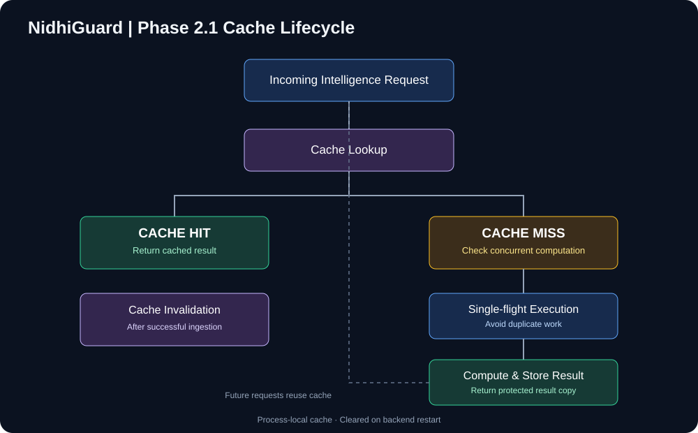

# NidhiGuard — MPLADS Intelligence & Investigation Prioritisation System

**An explainable anomaly-analysis and investigation-prioritisation platform for public infrastructure project data.**

NidhiGuard brings cost, project-similarity, contractor, billing, and geographic signals into a single workflow so that unusual patterns can be surfaced for human review. It is a decision-support tool: a risk indicator is not a finding of fraud or wrongdoing.

<p align="center">
  
</p>

## Engineering at a glance

| Area | Implementation |
|---|---|
| Web client | React, TypeScript, Vite, Tailwind CSS |
| API | Python, FastAPI |
| Data layer | SQLAlchemy, Neon PostgreSQL |
| Analytics | Pandas, NumPy, scikit-learn |
| Visualisation | Recharts |
| Access control | JWT authentication and role-based access control |
| Hosting | Vercel (frontend), Render (backend) |

## Analytical workflow

NidhiGuard evaluates five categories of signals and exposes the resulting indicators through risk-analysis and investigation workflows.

<p align="center">
  
</p>

| Signal | Analysis focus |
|---|---|
| Cost | Unusual project cost patterns |
| Project similarity | Potentially similar or duplicate projects |
| Contractor | Contractor-related patterns |
| Billing | Unusual billing patterns |
| Geographic | Location-based patterns |

The interface includes Risk Analysis, Investigation Queue, Contractor Intelligence, Geographic Intelligence, and Project Investigation views. The investigation workflow supports persistent records, notes, role-aware access, and append-only activity history.

## Phase 2.1 — In-process intelligence caching

Phase 2.1 reduces repeated analytical work by caching expensive, reusable computations inside the backend process.

<p align="center">
  
</p>

**Cached computations:** dataset loading, risk analysis, relationship analysis, geographic intelligence, and the TF-IDF similarity index.

**Implementation characteristics:**

- Cache lookup and reuse for repeated computations.
- Single-flight coordination to avoid duplicate concurrent computation for the same cache key.
- Deep-copy protection so consumers do not mutate shared cached results.
- Cache invalidation after successful ingestion.
- Non-blocking startup warm-up.
- Process-local memory; entries are cleared when the backend process restarts.

This is an in-process cache, not a distributed cache. Multiple backend instances do not share cache state.

### Local benchmark observations

| Operation | Before | After |
|---|---:|---:|
| Risk analysis | ~14–15 s | ~15–16 ms |
| Relationship analysis | ~11–12 s | ~158–192 ms |
| Geographic analysis | ~20 s | ~1.6 ms |

These are recorded **local benchmark** observations. They are not production latency guarantees and should not be compared with browser timings without controlling for network, cold starts, and deployment resources.

## Evaluation

The anomaly-analysis approach was evaluated against an independent synthetic benchmark.

| Metric | Result |
|---|---:|
| PR-AUC | **0.845** |
| Precision@20 | **0.85** |

The evaluation work included baseline comparisons, ablation analysis, and threshold calibration. These figures describe performance on the synthetic evaluation benchmark; they are not verified accuracy measurements on real-world government cases.

## Production deployment

<p align="center">
  
</p>

| Service | Platform | Endpoint |
|---|---|---|
| Frontend | Vercel | [Open application](https://nidhi-gaurd-gamma.vercel.app) |
| Backend API | Render | [API base URL](https://nidhigaurd-api.onrender.com) |
| Health check | Render | [`/health`](https://nidhigaurd-api.onrender.com/health) |
| Database | Neon | Managed PostgreSQL |

## Verification

The backend test suite passed after the Phase 2.1 integration:

- **304 passed**
- **1 non-blocking deprecation warning**

Production logs confirmed a dataset-cache miss followed by a hit. Other production cache-hit claims should be made only when corresponding risk, relationship, or geographic cache log entries have been observed.

## Run locally

### Backend

Requires Python, the project's backend dependencies, and a configured PostgreSQL connection.

```bash
cd backend
python -m venv .venv
```

Activate the virtual environment, install the dependencies listed in the repository, configure the required environment variables, and start the API:

```bash
pip install -r requirements.txt
uvicorn app.main:app --reload
```

### Frontend

Requires Node.js and npm. Configure the frontend API base URL for the local backend before starting:

```bash
cd frontend
npm install
npm run dev
```

Do not commit `.env` files, database credentials, JWT secrets, or API keys.

## Repository notes

The diagrams in [`docs/diagrams/`](docs/diagrams/) are SVG assets and can be edited as the architecture evolves. Keep them aligned with the implementation when services, cache behaviour, or deployment topology change.

## Responsible-use note

NidhiGuard is an independent software project, not an official government platform. It does not determine fraud, replace official audits, or make enforcement decisions. Its outputs are intended to help users prioritise records for further human investigation.

---

**Repository:** [jahnu-29/NidhiGaurd](https://github.com/jahnu-29/NidhiGaurd)
