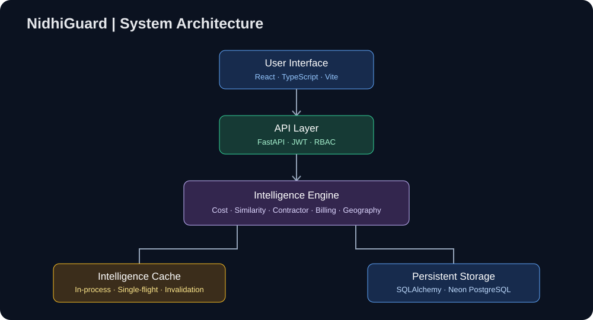
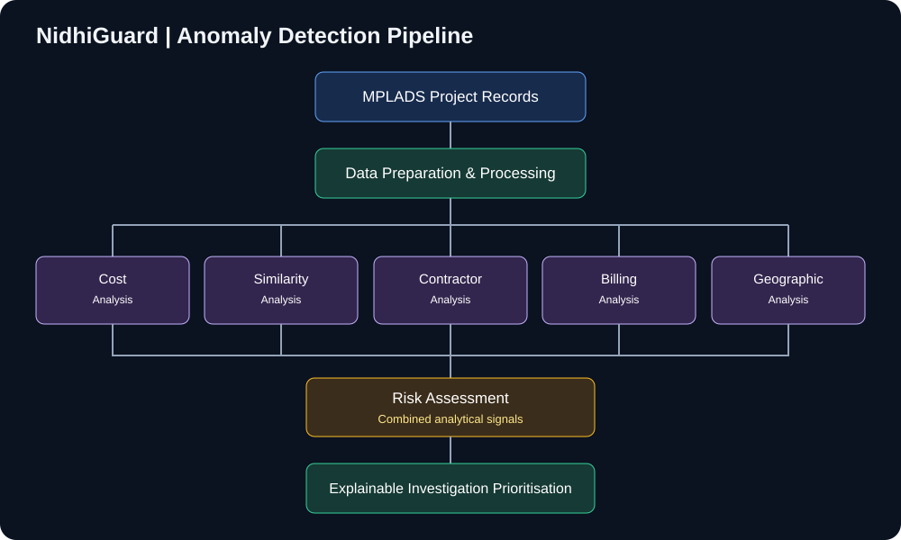
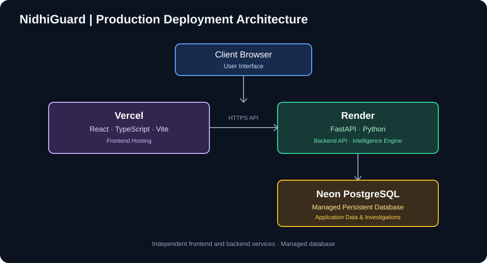

# NidhiGuard — MPLADS Intelligence & Investigation Prioritisation System

**Explainable anomaly scoring that helps reviewers decide which public-works projects to look at first.**

[**Live demo**](https://nidhi-gaurd-gamma.vercel.app) · [API health check](https://nidhigaurd-api.onrender.com/health) · [Evaluation report](evaluation/evaluation_report.md)

> **Prototype on synthetic data.** Every project, contractor, bill and payment in this repository and in the live demo is fictional, generated for a Smart India Hackathon prototype. Nothing refers to a real MP, contractor or transaction. NidhiGuard is an independent project, not an official government platform, and a risk score is **not** a finding of fraud.

<!-- Add a screenshot or GIF of the Investigation Queue here, e.g.  -->

## What it does

NidhiGuard combines five kinds of signals into a single 0–100 risk score per project, then gives reviewers a ranked queue, the evidence behind each score, and a place to record what they find.

| Detector | What it looks for |
|---|---|
| Cost | Sanctioned amount far above the comparable-group median, unsupported by the estimate |
| Project similarity | Near-duplicate projects, using TF-IDF + cosine similarity on descriptions plus shared attributes |
| Contractor | Repeated awards to one contractor in a short window, at inflated cost, in scattered districts |
| Billing | Bills compressed into a short burst, or heavily end-loaded |
| Geographic | Clusters of near-identical projects in close proximity |

**How scoring works.** The engine is deterministic and rule-based, not a trained model. Each detector scales itself to a fixed cap (cost 25, similarity 25, contractor 20, billing 20, geographic 10), and the capped scores are summed (max 100). Levels: LOW < 30 ≤ MEDIUM < 60 ≤ HIGH < 80 ≤ CRITICAL. The **investigation queue is every project that is not LOW** (score ≥ 30), ranked by score. Because every point of a score comes from a named detector, each result can be explained.

**Application.** Risk Analysis, Investigation Queue, Contractor Intelligence, Geographic Intelligence and Project Investigation views, with JWT login and three roles (admin, investigator, viewer). Investigations keep persistent records, notes, status changes and an append-only activity history.

## Architecture

[](docs/diagrams/architecture.svg)

| Area | Implementation |
|---|---|
| Web client | React 19, TypeScript, Vite, Tailwind CSS, Recharts |
| API | Python, FastAPI |
| Data layer | SQLAlchemy; SQLite by default locally, Neon PostgreSQL in production |
| Analytics | pandas, NumPy, scikit-learn (TF-IDF similarity; Isolation Forest used only as an evaluation baseline) |
| Access control | JWT authentication, role-based access control |
| Hosting | Vercel (frontend), Render (backend), Neon (database) |

[](docs/diagrams/anomaly-pipeline.svg)

## Evaluation

There is no public labelled ground truth for MPLADS irregularities, so the engine was evaluated on a **controlled synthetic benchmark** built independently of it. The engine was not tuned on this data, the labels were never given to any detector, and the dataset, labels and predictions are frozen by SHA-256 hash.

**Benchmark.** 150 projects: 49 anomalous (prevalence 32.7%) and 101 normal, of which 41 are *adversarial normals*: legitimate look-alikes such as a large honest contractor, nearby but unrelated projects, high-cost projects with documented extra scope, and milestone billing. Anomalies are built from documented rules in [`SCENARIO_SPEC.md`](evaluation/SCENARIO_SPEC.md), with obvious and borderline variants of each type.

### Ranking quality

| Metric | NidhiGuard | Random baseline |
|---|--:|--:|
| PR-AUC (average precision) | **0.845** | 0.327 |
| Precision@5 / @10 / @20 | 1.00 / 0.90 / 0.85 | 0.327 |
| Recall@20 | 0.347 (17 of 49) | — |

The bootstrap 95% interval for PR-AUC is [0.741, 0.934]. It is optimistic, because it resamples rows and ignores that the synthetic cases come in linked groups.

### Where it works and where it doesn't

The score ranks well, but its absolute values are compressed (max 55.5 on this set), so fixed thresholds miss many anomalies. Detection by anomaly type at the production queue cutoff (score ≥ 30):

| Anomaly type | Cases | Flagged at ≥ 30 |
|---|--:|--:|
| Multi-signal | 8 | 8 (100%) |
| Cost | 8 | 7 (88%) |
| Contractor pattern | 9 | 3 (33%) |
| Billing | 8 | 0 |
| Similar project | 8 | 0 |
| Geographic | 8 | 0 |

At that cutoff the queue has precision 0.857, recall 0.367 and a 3% false-positive rate (3 of 101 normals, all adversarial). At a stricter cutoff of 40: precision 0.90, recall 0.184. In short, the engine is good at putting anomalous projects *near the top* and good at not crying wolf, but single-signal billing, similarity and geographic anomalies usually score below the queue cutoff. That is the main thing to improve.

**Detector contribution (ablation).** Removing each detector and re-scoring changes PR-AUC by: similarity −0.110, cost −0.058, billing −0.051, geographic −0.034, contractor −0.027. The detectors were also compared against a cost-deviation baseline and an Isolation Forest on identical projects and labels; see [`baseline_comparison.md`](evaluation/baseline_comparison.md). Threshold and queue-size trade-offs are in [`calibration_report.md`](evaluation/calibration/calibration_report.md).

### Limits you should know about

- **This is not real-world accuracy.** A label says how a case was *constructed*. The scenario families mirror the detector families by design, so the benchmark tests the author's definition of suspicious, not external truth. [`SCENARIO_SPEC.md`](evaluation/SCENARIO_SPEC.md) §0 documents this and one disclosed exposure incident.
- Results on real data could be better or worse.
- The evaluation tests are not run in CI because they pin exact library versions; they are run locally.

Reproduce from the repository root:

```bash
python -m evaluation.generate_evaluation_data --out evaluation   # deterministic, seed 7919
pytest evaluation/tests -q
```

## Performance: Phase 2.1 in-process cache

Each analysis (dataset load, risk, relationships, geography, TF-IDF index) used to be recomputed on every request. Phase 2.1 caches them in the backend process with single-flight coordination (concurrent requests for the same key share one computation), deep-copy protection against mutation of shared results, invalidation after a successful ingestion, and a non-blocking startup warm-up (disable with `NIDHIGUARD_WARM_INTELLIGENCE_CACHE=0`).

| Operation | Recomputed every request | Cache hit |
|---|--:|--:|
| Risk analysis | ~14–15 s | ~15–16 ms |
| Relationship analysis | ~11–12 s | ~158–192 ms |
| Geographic analysis | ~20 s | ~1.6 ms |

These are **local sandbox timings** from [`scripts/phase_2_1_benchmark.py`](scripts/phase_2_1_benchmark.py), not production guarantees. The cache removes *repeated* work; it does not make the underlying computation faster, so the first request after a restart or a hosting spin-down still pays the full cost. The cache is process-local (not shared across instances) and is cleared when the process restarts.

## Run locally

Run everything from the **repository root**. The backend imports as `backend.app…`, so it will not start from inside `backend/`.

### Backend (Python 3.12+)

```bash
python -m venv .venv && source .venv/bin/activate      # Windows: .venv\Scripts\activate
pip install -r backend/requirements-dev.txt

cp backend/env.example backend/.env      # optional: set NIDHIGUARD_AUTH_SECRET (see file)
python -m backend.app.ingestion          # load the seed CSVs from data-source/data into the DB
python -m backend.app.auth.seed          # create demo users (see backend/README_AUTH.md)
python -m uvicorn backend.app.main:app --reload      # http://127.0.0.1:8000
```

Check it with `curl http://127.0.0.1:8000/health`. The database defaults to SQLite at `backend/nidhiguard.db`; set `NIDHIGUARD_DATABASE_URL` to use PostgreSQL. The seeded accounts use **demo-only passwords** documented in [`backend/README_AUTH.md`](backend/README_AUTH.md). Never use them for a real deployment; override them with the `NIDHIGUARD_DEMO_*_PASSWORD` variables.

### Frontend (Node 22)

```bash
npm ci
PORT=5173 npm run dev                    # Windows (cmd): set PORT=5173 && npm run dev
```

The dev server defaults to port 8443, but the backend only allows the origins `http://localhost:5173` and `http://127.0.0.1:5173` (plus LAN addresses on port 8443), so set `PORT=5173` to avoid CORS errors on localhost. The frontend talks to `http://127.0.0.1:8000` unless you set `VITE_API_BASE_URL` in a `.env` file.

### Tests

```bash
python -m pytest -q
```

The suite (`intelligence/tests` + `backend/tests`) was last run on 7 Nov 2026 with Python 3.12 and current library versions: **374 passed, 1 deprecation warning**. CI pins Python 3.13 and exact library versions (see [`.github/workflows/ci.yml`](.github/workflows/ci.yml)).

## Repository layout

| Path | Contents |
|---|---|
| `src/` | React frontend (pages, API client, auth) |
| `backend/` | FastAPI app: API routes, auth/RBAC, investigation workflow, DB models, CSV ingestion, cache |
| `intelligence/` | The five detectors, the risk engine and their tests |
| `evaluation/` | Synthetic benchmark, baselines, ablation, calibration, reports and frozen manifests |
| `data-source/` | Synthetic data generator and the seed CSVs (200 projects, 75 contractors) |
| `scripts/` | Cache benchmark and data-conversion scripts |
| `docs/diagrams/` | Architecture, pipeline, cache-lifecycle and deployment diagrams |

`backend/V2_6_SOURCE_INTEGRITY.md` explains the SHA-256 manifests that tie the frozen evaluation runs to the code they ran on. If you change files under `backend/app/` or `src/`, those integrity tests will tell you, so record intentional changes in `backend/post_v2_6_changes.json` rather than editing manifests by hand.

## Deployment

[](docs/diagrams/deployment.svg)

| Service | Platform | Endpoint |
|---|---|---|
| Frontend | Vercel | [nidhi-gaurd-gamma.vercel.app](https://nidhi-gaurd-gamma.vercel.app) |
| Backend API | Render | [nidhigaurd-api.onrender.com](https://nidhigaurd-api.onrender.com) · [`/health`](https://nidhigaurd-api.onrender.com/health) |
| Database | Neon | Managed PostgreSQL |

## Known limitations and next steps

- Detection of single-signal billing, similarity and geographic anomalies is weak at the current thresholds (see the evaluation above).
- All data is synthetic; the system has not been validated against real MPLADS records.
- The cache is process-local, so it is not shared across instances and is lost on restart.
- Never commit `.env` files, database credentials, JWT secrets or API keys.

## Responsible use

NidhiGuard helps users prioritise records for further human investigation. It does not determine fraud, replace official audits or make enforcement decisions.
